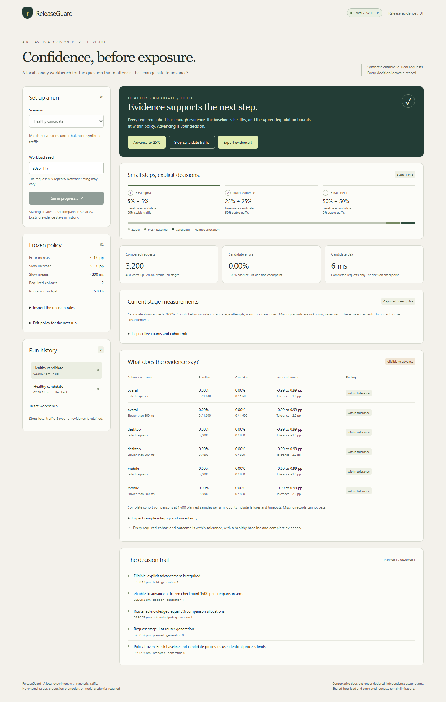

# ReleaseGuard

A local release safety workbench for engineers deciding whether a candidate service can advance. It sends real HTTP traffic through a router to fresh baseline and candidate processes, compares error and slow-request rates by cohort, and verifies withdrawal with subsequent version-tagged requests.



Developed in November 2026 by Harold Ng with Codex implementation and verification assistance. This is a synthetic local experiment, not a production rollout controller. No account, API key, paid service, or external traffic target is needed.

## Run from a fresh checkout

Install Node **24.14 or later in the 24.x line** and npm. Then:

```sh
git clone https://github.com/ngyathin16/releaseguard.git
cd releaseguard
npm ci
npm run build
npm start
```

Open **http://127.0.0.1:4318**. Select **Healthy candidate**, inspect the policy, and start. When eligible, explicitly advance to 25% and then 50%. Completion ends the local experiment and withdraws candidate traffic. Try **Mobile cohort regression**, **Lost telemetry**, or **Candidate crash** next. **Reset workbench** stops the local stack while keeping saved evidence; starting again creates fresh services. To start with empty history, stop the application and choose a new `RG_DATABASE` file path before starting.

The controller binds to loopback and only routes to its own bundled services. Local SQLite history defaults to `data/releaseguard.sqlite`. `PORT` changes the interface port; `RG_DATABASE` selects the database path. Development UI: `npm run dev` alongside the controller. The backend accepts only its own loopback origin; use the production build for the verified workflow.

## What a decision means

- **Eligible to advance:** the baseline satisfies its absolute health policy, each required cohort has enough complete evidence, the workloads are comparable, control state is reconciled, and every upper degradation bound fits within its practical tolerance.
- **Regression detected:** a lower degradation bound exceeds tolerance with valid comparison evidence. A failing baseline still blocks advancement.
- **Inconclusive:** evidence does not establish either decision, or required measurements/control state are incomplete. It never authorizes advancement.

Operational stops are separate from statistical findings. Missing telemetry stops traffic after the frozen grace period. A gross failure threshold or expired lease can withdraw traffic between statistical checkpoints. Withdrawal is confirmed only after router acknowledgement and subsequent requests reach the baseline. Already in-flight requests may still complete or time out.

Stages allocate equal baseline/candidate traffic: **5%/5%**, **25%/25%**, then **50%/50%**. A separate stable process receives the remainder. Stage advancement is explicit and generation-fenced. There is no full production promotion.

## Evidence and verification

```sh
npm test
npm run build
npm run verify:runtime
# With npm start running in another terminal:
npm run verify:browser
npm run reanalyze -- path/to/export.json
npm run verify:recording
```

Browser verification uses Microsoft Edge on Windows. On Linux, install Playwright Chromium with `npx playwright install chromium`, or set `BROWSER_EXECUTABLE`. Runtime tests create independent local processes and databases. The full live suite repeats each bundled scenario three times and retains compressed request records.

[Verification](docs/VERIFICATION.md) records actual environments and results. [Statistical design](docs/STATISTICS.md) explains assumptions, sample budgets, reference calculations and the frozen simulations. The [captioned walkthrough](docs/walkthrough.webm) shows the real application; [captions](docs/walkthrough.vtt) and [capture details](docs/WALKTHROUGH.md) accompany it. Exported JSON contains the frozen policy, source/configuration fingerprints, environment, raw observations, decisions and control events; `reanalyze` checks recorded judgments against the recorded input.

## Architecture

```text
React workbench → local HTTP controller → SQLite run/event history
                              ↓ fenced commands / renewable lease
seeded matched traffic → router → stable / fresh baseline / candidate
                              ↓ request evidence
                independent analysis module → judgment + export
```

The controller, router and three catalogue services are separate Node processes. A seeded generator balances cohorts across comparison arms and shuffles request ordering. Services have identical process settings; only the selected fault configuration differs. Warm-up observations are excluded. Binary error/slow rates use Clopper–Pearson intervals with a Bonferroni allocation over both tails, both arms, all outcomes, required cohorts, stages and planned checkpoints. p95 describes completed requests only. See [architecture and tradeoffs](docs/ARCHITECTURE.md).

## Limits and provenance

Synthetic fixtures are authored for this project and contain no customer data. Statistical simulations assume independent Bernoulli request outcomes; the separately reported correlated stress suite does not establish a universal error bound. Local HTTP timing shares the host with other processes. Conservative intervals can leave healthy runs inconclusive. No human usability study or production deployment is claimed. SQLite remains an experimental Node API in the tested Node release.

The project adapts the problem framing of [Netflix's Kayenta canary analysis](https://netflixtechblog.com/automated-canary-analysis-at-netflix-with-kayenta-3260bc7acc69), [Netflix's discussion of repeated testing](https://netflixtechblog.com/sequential-a-b-testing-keeps-the-world-streaming-netflix-part-1-continuous-data-cba6c7ed49df), and [Meta's configuration-canary episode](https://engineering.fb.com/2026/04/08/security/trust-but-canary-configuration-safety-at-scale-meta-tech-podcast/). It does not implement their platforms or claim affiliation, endorsement or comparable scale.

Source is publicly readable. No new source-code license has been selected; public visibility does not grant a software license. Third-party dependencies retain their own notices. See [change record](docs/CHANGELOG.md) and [project requirements](docs/REQUIREMENTS.md).
