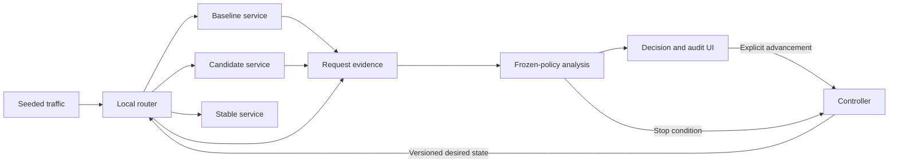

# ReleaseGuard requirements
Implementation requirements from the portfolio project brief, 16 November 2026. Acceptance evidence is recorded separately.
## 5. ReleaseGuard

### User problem and promise

An engineer changes a timeout or cache setting. Overall average latency looks normal, but one endpoint or customer cohort experiences failures. A manual graph review can miss the change, and missing telemetry can look like an improvement.

ReleaseGuard helps answer: **“Does the measured candidate remain within the configured tolerances, and what happened when we stopped it?”** The first release controls a local demonstration service. It is not a production deployment controller.

### Required demonstration

1. Launch a bundled read-only catalogue service in stable, fresh baseline, and candidate processes, a local router, and a seeded traffic generator.
2. Select a healthy configuration or one that harms a named cohort. Inspect the analysis policy before starting.
3. Start a canary. Observe real request counts, error rates, p95 latency, cohort distribution, and candidate exposure.
4. See a healthy candidate become eligible to advance, a clear regression trigger a stop, or incomplete evidence produce a hold.
5. Inspect the decision packet, then verify from router/request records that new traffic stopped reaching the candidate.
6. Repeat with lost telemetry or a controller restart and inspect recovery.

Live measurements must come from executed HTTP requests. Recorded runs may provide a fast visitor walkthrough, but must identify their capture time and replay mode throughout.

### P0 functional requirements

| ID | Requirement and observable acceptance |
| --- | --- |
| R1 | Start and reset the complete local stack from documented commands. Use fresh baseline/candidate instances with matching resources, warm-up, offered load, and randomized cohort-balanced request mix; a separate stable instance handles remaining traffic. Record achieved request rate/concurrency per arm, build/config fingerprints, and workload seed. Do not compare a cold candidate with a warmed long-lived baseline. |
| R2 | Before a run, freeze the metric definitions, required cohorts, practical regression tolerances, planned checkpoints, sample minimums, and statistical method. Editing policy creates a new run. Display the policy with every result. |
| R3 | Capture request outcomes, timeouts, elapsed duration, version, route, cohort, and monotonic timing. Reconcile attempted, completed, failed, and missing requests. Empty/missing telemetry is never treated as zero latency or zero errors. |
| R4 | Show overall and cohort-specific error and slow-request rates, with sample counts and uncertainty; show p95 latency as descriptive context. A missing or underpowered required cohort prevents promotion even when the aggregate looks healthy. Separate warm-up from measurement, check workload comparability, and require the baseline to satisfy its absolute health policy. Both versions failing together must block advancement. |
| R5 | Return `eligible to advance`, `regression detected`, or `inconclusive`, with the checks that determined it. A statistically inconclusive run does not pass. Show an operational emergency stop separately from a statistical regression conclusion. |
| R6 | Demonstrate staged exposure with equal baseline/candidate allocation: 5%/5% with 90% stable traffic, then 25%/25% with 50% stable, then 50%/50%. Advancing requires an eligible result and an explicit user action; the local system automatically withdraws candidate traffic on a stop condition. A stage that lacks samples at its time limit remains inconclusive. Completion means the 50% stage passed; v1 does not perform full production promotion. |
| R7 | Persist planned and observed router generations. A stop request is not a successful rollback until router acknowledgement and subsequent request observations confirm it. Fence stale commands using generation comparisons; a delayed advance cannot revive a stopped run. On controller restart, reconcile observed state before allowing advancement. Router lease expiry returns new traffic to the baseline. |
| R8 | Export the run manifest, policy, decision evidence, request/metric summaries, control events, and workload/environment details. Re-analyzing the recorded input with the same version produces the same judgment; a new live run need not reproduce identical timing. |

Statistical design is a first implementation milestone. For P0, judge two binary outcomes: failed requests and requests exceeding a fixed duration threshold. Start with a finite, predeclared set of decision checkpoints and simultaneous intervals accounting for outcomes, cohorts, checkpoints, both arms, and interval tails. Use conservative binomial bounds and a run-wide nominal 5% interval error budget, checked against reference calculations under stated independence assumptions. The bounds support both advancement and regression judgments; correlated workloads require separate stress reporting. Live charts do not authorize extra tests. Do not repeatedly apply an unadjusted fixed-horizon test or claim to implement Netflix’s sequential method without doing so.

Passing requires the upper degradation bound to lie within a practical tolerance; regression requires the lower bound to exceed it. Otherwise the result is inconclusive. Initial fixture policy: an error-rate increase tolerance of 1 percentage point and a slow-request-rate increase tolerance of 2 percentage points, where slow means over 300 ms. Require baseline error rate at most 1% and slow-request rate at most 5%. These are proposed demonstration settings, not universal SLOs. Pilot runs must establish sample requirements and achievable precision before freezing the evaluation policy. User-chosen tolerances and statistical uncertainty remain visible. P95 is descriptive and does not create another significance test.

Hard-stop policy, such as sustained gross error rate or an expired control lease, can act between statistical checkpoints. Its purpose is limiting local exposure; report it as a policy stop, not a confidence statement. Missing/stale telemetry immediately prevents advancement; after a predeclared grace period of at most 5 seconds, withdraw candidate traffic and finish as inconclusive. Timeouts count as failures and as slow when their deadline exceeds the slow threshold. Keep censored durations visible and label p95 over completed requests as such; never imply it includes unknown completion times.

### Architecture and state

Proposed implementation: Node.js/TypeScript controller, router, sample HTTP services and load generator; SQLite run/event storage; React/TypeScript UI. The stable instance and fresh baseline run the same known-good version; only baseline/candidate measurements enter the comparison. On withdrawal, the router sends new traffic to the known-good pool. Use a separate, testable analysis module. Decide the statistical implementation after a short numerical-method spike with reference calculations. Avoid Kubernetes, Kafka, and a custom telemetry warehouse in v1.

Core records: immutable run manifest, stage, policy version, request observation, metric window, judgment, and control event. Keep analysis outcomes separate from rollout states. Rollout states include `prepared`, `running`, `held`, `stopping`, `rolled back`, `completed`, and `interrupted`. Duplicate control requests must not advance a stage twice. Read actual router state when recovering; never infer success solely from a database status.

Route only to the bundled local services in v1. Bind the control interface to localhost; the project must not become an arbitrary traffic generator or outbound proxy. State the limit of rollback: new requests move to baseline; already in-flight requests may complete or time out. Synthetic workload generation uses no customer data.

### Evaluation and acceptance

Required scenario families: healthy candidate; broad latency regression; tail-only regression; cohort-only regression; configuration-induced errors; insufficient traffic; missing metrics; unbalanced workload; unhealthy baseline/shared dependency; candidate crash; controller restart during stop; repeated or stale stop/advance requests; and router lease expiry.

- Run end-to-end tests against real local processes and HTTP traffic for every family, retaining the raw observations. A short prerecorded chart cannot satisfy this gate.
- Before evaluation, freeze 200 no-regression simulations and 100 above-tolerance regression simulations across several latency distributions and cohort mixtures, plus a separately reported boundary suite just below/at/above each tolerance. Separate these from tuning data; document assumptions, seeds, effect sizes, and sample sizes. Large-effect detection targets do not apply to barely distinguishable boundary cases, which may correctly remain inconclusive.
- Target no more than 5% statistical false regression flags in the no-regression simulations and at least 90% detection for the prespecified above-tolerance effects within the planned sample budget. Report counts and uncertainty intervals; 200 simulations cannot prove a universal error bound.
- Also report false advancement, correct advancement, and inconclusive rates. Target no more than 5% false advancement across the above-tolerance simulations. Require zero advancement in missing-data, unhealthy-baseline, underpowered-cohort, invalid-comparison, and unresolved-control-state scenarios. Never hide inconclusive runs by removing them from denominators.
- Repeat each live fault scenario at least 3 times. Target confirmed withdrawal of new candidate traffic within 2 seconds of a stop decision on the declared local environment; measure from the decision timestamp to observed router change, excluding already in-flight requests. Report any violation.
- Kill and restart the controller during a stop. Confirm baseline routing and recovery before advancement becomes available. Prove this through requests carrying version IDs, not only an audit message.
- Baseline comparisons: simple overall-threshold judgment and the predeclared cohort-aware method use the same captured inputs. Show where added complexity changes a useful decision and where it adds delay or inconclusive outcomes.

P1 after P0: importing a documented telemetry format, one read-only metrics integration, or an additional canary policy. Non-goals: real cluster deployment, destructive chaos against external services, automatic incident root-cause claims, multi-region availability, or Netflix/Meta-scale guarantees.

## 6. Shared product quality bar

“Ultra-high-quality” means the following are required deliverables, not adjectives in the project description:

- **Complete workflow:** sensible first-use examples, useful empty/loading/error states, cancel/retry/reset, persistent context, and no decorative or nonfunctional controls.
- **Clear evidence:** plain-language findings first, with SQL/request/statistical detail available when needed. Avoid raw infrastructure terminology in the primary user journey.
- **Visual craft:** purposeful layouts, consistent spacing/type/color, readable charts/tables, restrained motion, and real product screenshots. Reuse the portfolio’s warm neutral visual direction where appropriate without forcing the applications into its static layout.
- **Accessibility:** keyboard completion, visible focus, semantic labels, announced asynchronous status, non-color-only results, and checks at 360, 768, and 1440 px. Dense SQL/tables may scroll within labeled regions; the page must not overflow. Target WCAG 2.2 AA behavior without claiming certification.
- **Reproducibility:** locked dependencies, documented fresh-checkout startup, deterministic seed generation, fixture provenance/license, verification commands, and a clean reset. Verify on Windows and one Linux environment; record actual tested versions.
- **Operational honesty:** live, deterministic, and replay modes are distinguishable. Failed model calls, incomplete measurements, and interrupted execution never appear as completed success.
- **Evidence package:** README, architecture/tradeoffs, evaluation dataset and manifest, raw results, failure analysis, screenshots, and a 60–90 second captioned walkthrough. Every claimed result links to a reproduction artifact.

Validate usability with three representative reviewers if available: an analyst, a service engineer, and a technically literate person unfamiliar with the project. Target unaided completion of each product’s core story within five minutes after launch. Record task completion, confusing steps, and revisions; do not describe agent/browser testing as human validation. Lack of access to participants is disclosed rather than replaced with invented feedback.

